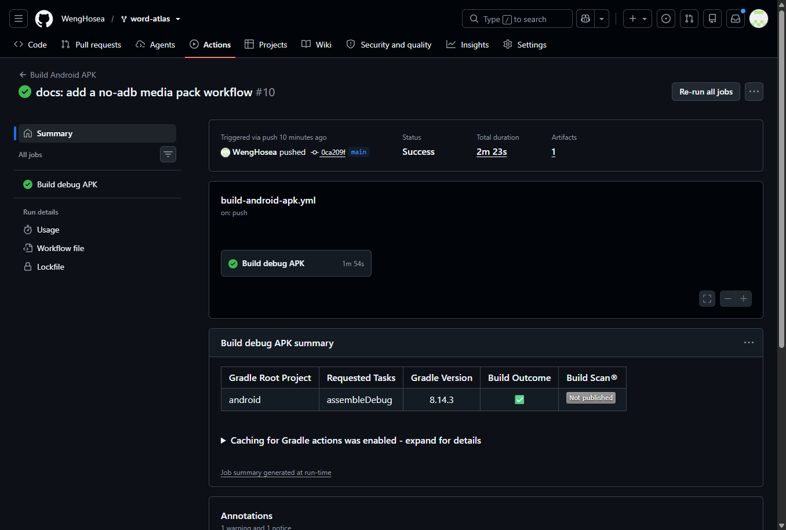
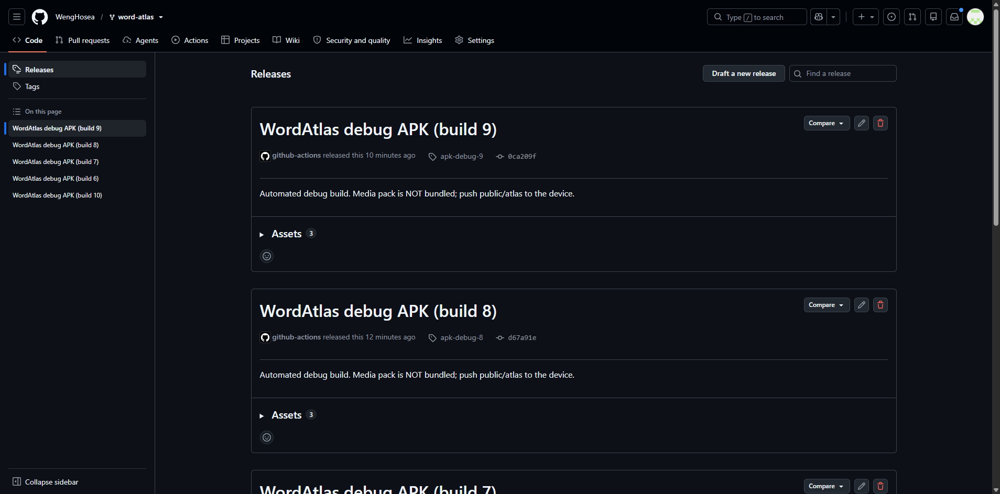

# 词光 Word Atlas · 手机端安装与数据包导入操作指南

本文档说明如何用 GitHub Actions 在云端打出 Android 安装包（APK），以及如何把
体积较大的离线媒体包（插画 + 音频）导入手机，让 App 立刻可用。


## 架构速览

```
┌──────────────────────────────┐        ┌──────────────────────────────┐
│  GitHub Actions (ubuntu)      │        │  Android 手机                  │
│  ├─ npm run build:mobile      │        │  ├─ WordAtlas.apk  (~14 MB)   │
│  │   （媒体目录临时移出）      │        │  │   词库索引 + entries JSON     │
│  ├─ npx cap sync android      │  APK   │  │   WebView 壳 + Capacitor     │
│  └─ gradlew assembleDebug     │ ─────► │  └─ /Android/data/.../files/   │
└──────────────────────────────┘        │       atlas/  ← adb push 媒体包 │
                                        │         img/ thumb/ audio/      │
                                        └──────────────────────────────┘
```

- APK 内只带**词库索引**（`index.json`）和 **73 个词条 JSON 分片**（`entries/`），
  用来保证秒开。
- 图片与音频**不打包**，运行时从手机外部存储读取（OBB 模式）。
- 媒体根目录可在「我的」页切换：应用私有目录 ↔ `/sdcard/Download/word-atlas/atlas`。

## 一、在云端打出 APK

### 1.1 触发构建

1. 打开仓库 **Actions** 页签：<https://github.com/WengHosea/word-atlas/actions>
2. 左侧选择工作流 **Build Android APK**
3. 点击右侧绿色按钮 **Run workflow** → 确认分支 → 等待约 2–4 分钟

> 也可以直接 `git push` 到 `main` / `mobile` 分支，工作流会自动触发。

### 1.2 等待构建完成



页面顶部 **Status** 变成绿色的 `Success` 即成功；红色 `Failure` 时点开失败步骤，
右侧展开日志能看到具体报错。

### 1.3 下载 APK

两条路，任选其一。

**方式 A · Releases（推荐，无需登录）**

工作流每次成功都会把 APK 挂到 Releases，链接固定格式：

```
https://github.com/WengHosea/word-atlas/releases/download/apk-debug-<运行号>/app-debug.apk
```

本次已发布的版本：**`apk-debug-10`**

```powershell
# 直接下载到本机
Invoke-WebRequest "https://github.com/WengHosea/word-atlas/releases/download/apk-debug-10/app-debug.apk" -OutFile D:\Downloads\app-debug.apk
```

也可以在 <https://github.com/WengHosea/word-atlas/releases> 页面点击 `app-debug.apk` 下载。



**方式 B · Actions Artifacts**

1. 打开本次运行详情页，滚到页面底部 **Artifacts** 区域
2. 点击 **`word-atlas-debug-apk`** 下载（是个 zip，解压后就是 `app-debug.apk`）

> Artifacts 需要登录 GitHub 才有权限下载；Releases 方式不需要。

## 二、把 APK 装到手机上

1. 手机 **设置 → 其他设置 → 开发者选项** → 打开 **USB 调试**
2. 用数据线连电脑，手机上弹出「允许 USB 调试」时点**允许**
3. 把 `app-debug.apk` 传到手机（数据线拷贝 / 微信文件传输助手均可）
4. 点击安装。首次安装会提示「未知来源应用」，按提示允许即可

也可以用 MTP 脚本直接推（无需 adb）：

```powershell
powershell -ExecutionPolicy Bypass -File scripts/push-apk.ps1 -Apk D:\Downloads\app-debug.apk
```

推完在手机「文件 → Download」里就能看到它，文件名带 `-v10` 后缀的是最新版。

> ⚠️ **坑**：MTP 脚本如果按目录名全局匹配 `Download`，会误命中本机的
> 「百度网盘 → AutoUpdate → Download」，文件会传到电脑上，手机里根本找不到。
> 仓库里的脚本已限定只在手机的「内部存储」下查找。

也可以直接用 adb 安装：

```powershell
adb install -r "D:\Downloads\app-debug.apk"
```

## 三、导入离线媒体包（关键步骤，约 620 MB）

媒体包在电脑上的位置：`D:\project\github\word-atlas\public\atlas\`

```
public/atlas/
├── index.json      ← 已经在 APK 里，不用管
├── entries/        ← 已经在 APK 里，不用管
├── img/            ← 7,298 张插画  (184.7 MB)  ← 要推
├── thumb/          ← 7,298 张缩略图 (69.8 MB)  ← 要推
└── audio/          ← 22,905 段音频 (366 MB)   ← 要推
```

### 3.0 免 adb 路线：打成 zip，App 自己解压（推荐给普通用户）

媒体包有 **37,576 个文件**。用 MTP / 资源管理器一个一个复制过去，实测速率只有
**4.5 个文件/秒**，全部推完要 **2 小时 40 分钟**；而单个大文件传得飞快
（100 MB 不到 2 分钟）。所以正确做法是**先压成一个 zip，再让 App 自己解压**。

**第 1 步 · 在电脑上打包**

```powershell
cd <仓库目录>
node scripts/pack-atlas-zip.mjs D:\Downloads\atlas.zip
```

输出约 **616 MB** 的 `atlas.zip`。

**第 2 步 · 把 zip 放进手机的 App 目录**

用数据线连电脑，手机上会弹出「允许访问文件」→ 选**传输文件 (MTP)**，
然后把 `atlas.zip` 复制到：

```
/内部存储/Android/data/com.haoxin.wordatlas/files/atlas.zip
```

> Windows 资源管理器默认看不到 `Android/data`，用「文件」App 或任意 MTP
> 工具都行；也可以直接用下面的命令行（Windows PowerShell）：

```powershell
# 一条命令推完（MTP 通道，无需 adb）
.\scripts\push-atlas.ps1 -Zip D:\Downloads\atlas.zip
```

**第 3 步 · 打开 App**

首次启动时 App 会自动解压 `atlas.zip` 到
`/storage/emulated/0/Android/data/com.haoxin.wordatlas/files/atlas/`，
大约需要 1–3 分钟（取决于手机存储速度）。解压完成后插画与音频即可正常显示。

也可以在 **我的 → 导入媒体包（atlas.zip）** 手动触发一次，
弹窗提示「媒体包已就绪：37,576 个文件」即成功。

> 解压完可以删掉手机里的 `atlas.zip`，释放 616 MB 空间。

### 3.1 用 adb 一键推送（推荐）

```powershell
# 1) 创建目标目录
adb shell mkdir -p /sdcard/Android/data/com.haoxin.wordatlas/files/atlas

# 2) 推送整个媒体包（约 620 MB，视 USB 速度约 3–8 分钟）
adb push "D:\project\github\word-atlas\public\atlas\*" /sdcard/Android/data/com.haoxin.wordatlas/files/atlas/

# 3) 删掉 .nomedia 标记，否则系统媒体库会忽略该目录
adb shell "cd /sdcard/Android/data/com.haoxin.wordatlas/files/atlas && find . -name .nomedia -delete"
```

> `npm run build:mobile` 结束时会自动打印上面这三行命令，可直接复制。

### 3.2 不用 adb 的替代方案（逐文件复制，较慢）

手机连接 Wi-Fi 后，用「文件管理 → 电脑 → SMB」或数据线把整个 `public/atlas`
文件夹复制到：

```
/storage/emulated/0/Android/data/com.haoxin.wordatlas/files/atlas/
```

复制完成后打开 App，进入 **我的 → 媒体包路径**，确认显示为
`/storage/emulated/0/Android/data/com.haoxin.wordatlas/files/atlas`。

> 注意：Android 11+ 的系统文件管理器通常不允许写入 `Android/data` 子目录。
> 若无法写入，请改用 3.1 的 adb 方式，或把包放到
> `/sdcard/Download/word-atlas/atlas` 再在「我的」页切换媒体根路径
> （Android 10 及以下无需额外授权；11+ 需要手动授予「所有文件访问权限」）。

## 四、验证安装

1. 打开 **WordAtlas**，首屏应直接进入「今日计划」卡片流（不会加载耗电的 WebGL 星图）
2. 任意进入一个单词：**插画**与**英/美发音**应正常显示与播放
3. 进入 **我的** 页面，底部「媒体包路径」应显示当前路径与状态
4. 底部 **FSRS 评分条**（Again / Hard / Good / Easy）应固定在屏幕拇指热区

若插画显示占位图、顶部弹出「未检测到离线媒体包」，
说明媒体包路径不对，回到「我的」页切换媒体根路径，或重新执行 3.1。

## 五、常见问题

| 现象 | 原因与处理 |
| --- | --- |
| 弹出「未检测到离线媒体包」 | 媒体没推全或路径不对，检查「我的 → 媒体包路径」 |
| 有插画没声音 | `audio/` 没推全，重新 push 该目录 |
| `adb push` 报 `Permission denied` | 目标目录不存在，先执行 `adb shell mkdir -p ...` |
| `adb push` 报 `device unauthorized` | 手机上「允许 USB 调试」的弹窗没点，或先 `adb kill-server` |
| 想改用下载目录 | 把包放到 `/sdcard/Download/word-atlas/atlas`，然后在「我的」页切换 |
| 想恢复进度 | 「我的 → 从本地沙盒恢复备份」，读取 `progress-backup.json` |

### 5.1 云端构建踩过的坑（已修复，仅供维护参考）

| 报错 | 根因 | 修复 |
| --- | --- | --- |
| `Warning: Failed to find package 'tools'` | `android-actions/setup-android@v3` 会执行已被下线的 `sdkmanager tools` | 弃用该 action，直接用 runner 预装的 `sdkmanager` 装 `platforms;android-36` / `build-tools` |
| `The Capacitor CLI requires NodeJS >=22.0.0` | Capacitor CLI 8 强制 Node ≥ 22，原方案的 Node 20 不满足 | 工作流改用 Node 22 |
| `error: invalid source release: 21` | Capacitor 8 的 android 库以 source/target 21 编译，JDK 17 不够 | 改用 Temurin JDK 21，并在 `app/build.gradle` 显式声明 `JavaVersion.VERSION_21` |
| `./gradlew: Permission denied` | git 在 Windows 上检出时丢了可执行位 | 构建步骤先 `chmod +x gradlew` |
| `gh: Resource not accessible by integration` | 默认 `GITHUB_TOKEN` 没有 `contents: write`，无法建 Release | 在 job 上加 `permissions: contents: write` |

## 六、后续可做的增强

- **Release 签名包**：在仓库 Secrets 里配置 `ANDROID_KEYSTORE_BASE64` /
  `ANDROID_KEYSTORE_PASSWORD` / `ANDROID_KEY_ALIAS` / `ANDROID_KEY_PASSWORD`，
  然后放开工作流中被注释的 `assembleRelease` 步骤。
- **换包名**：改 `capacitor.config.ts` 的 `appId` 与
  `android/app/src/main/java/com/haoxin/wordatlas/MainActivity.java` 的包路径，
  再 `npx cap sync android`。
- **免 adb 导入（已实现）**：App 内置 `MediaPackPlugin`，启动时自动检测并解压
  App 私有目录下的 `atlas.zip`；也可在「我的 → 导入媒体包（atlas.zip）」手动触发。
